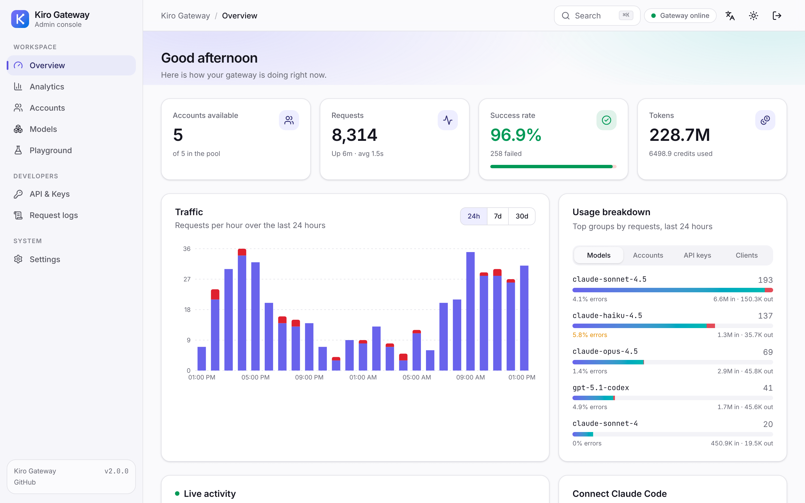
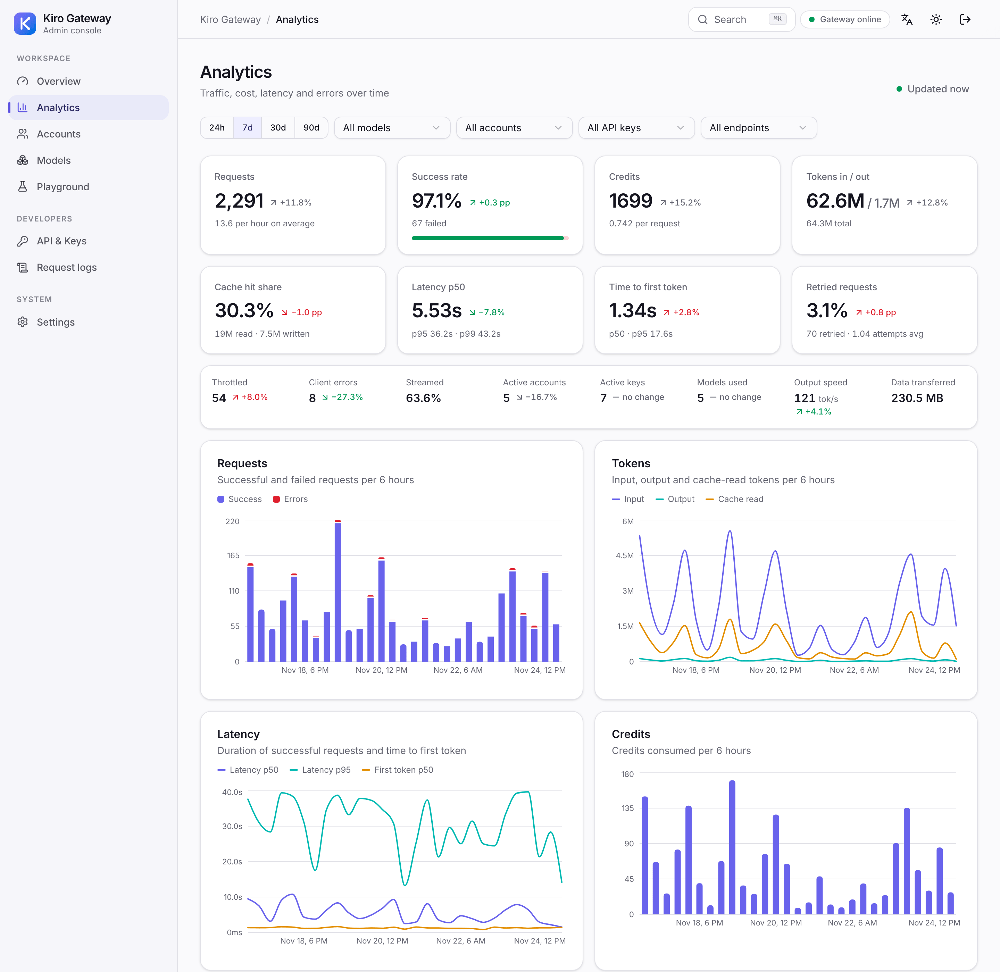
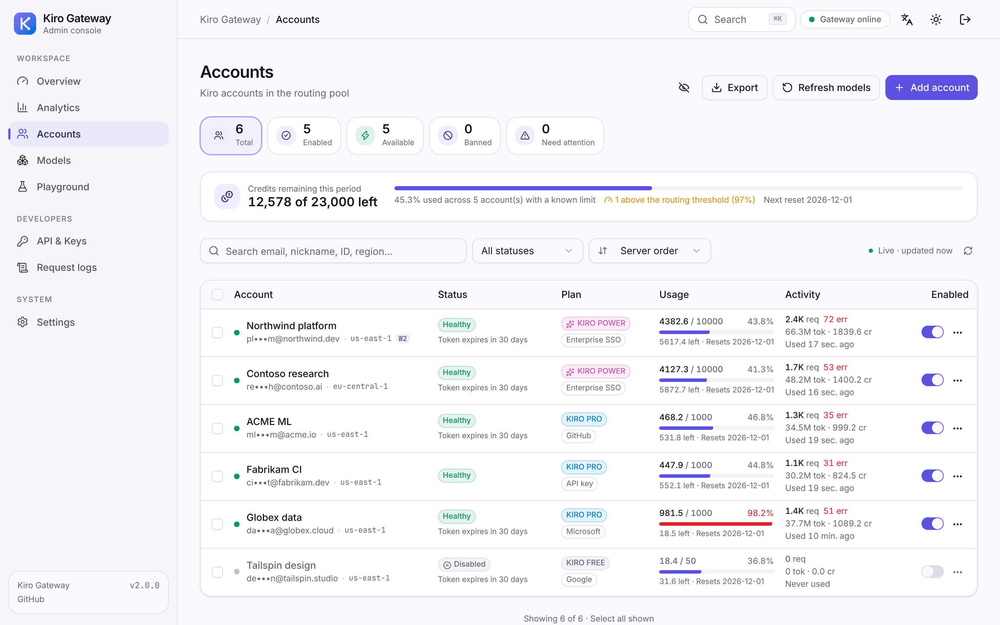
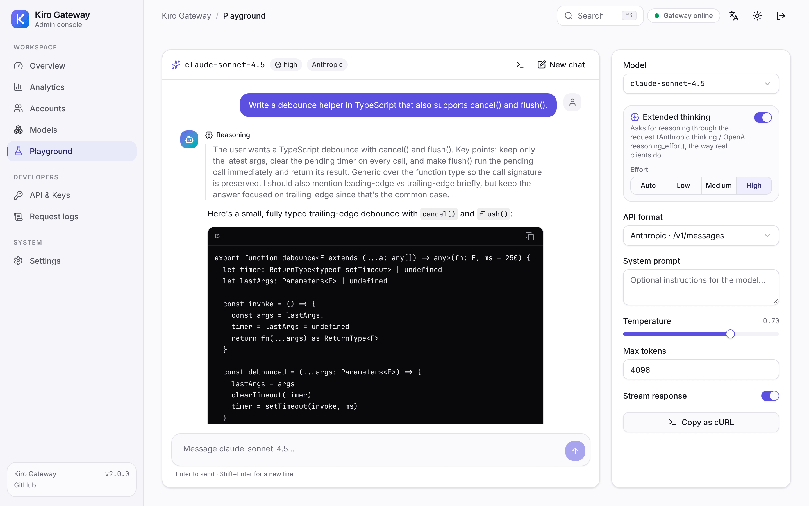
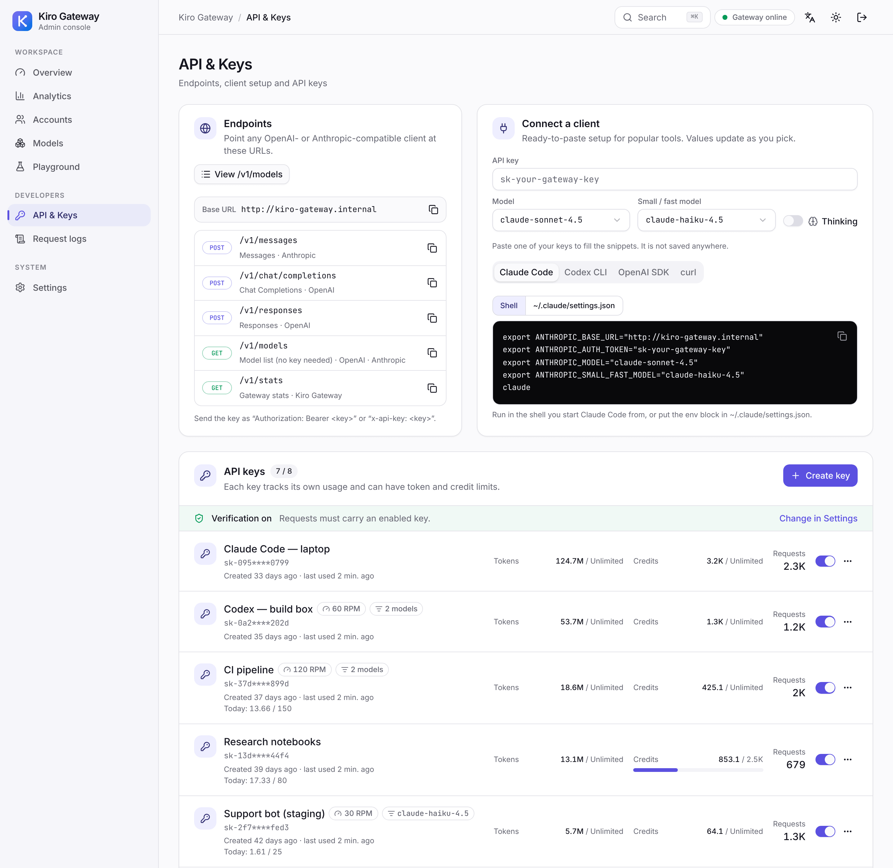
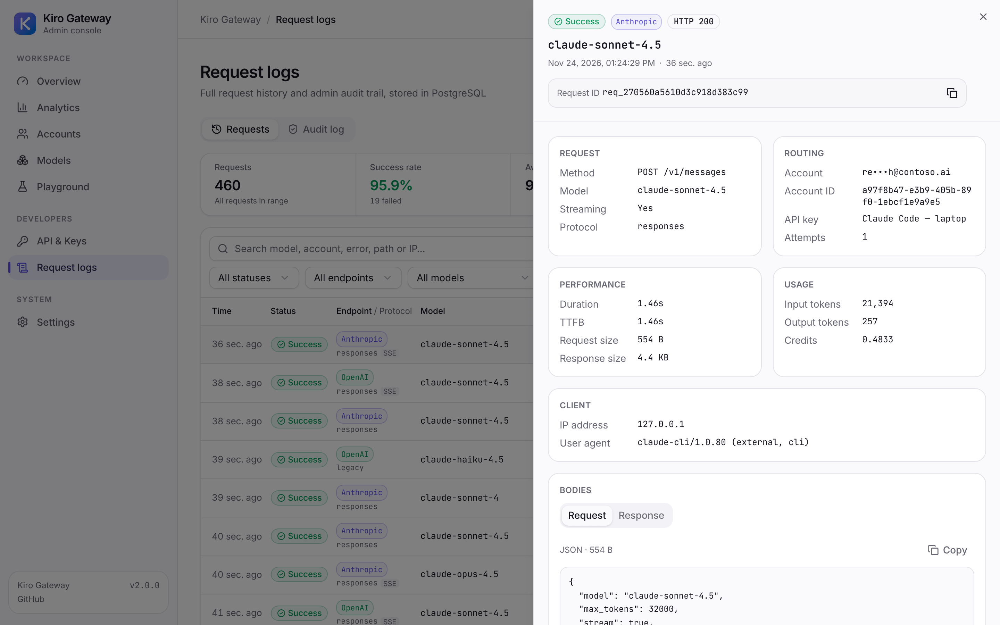
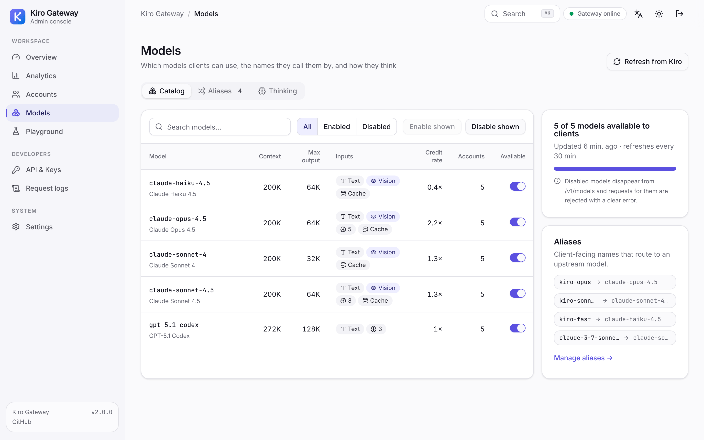
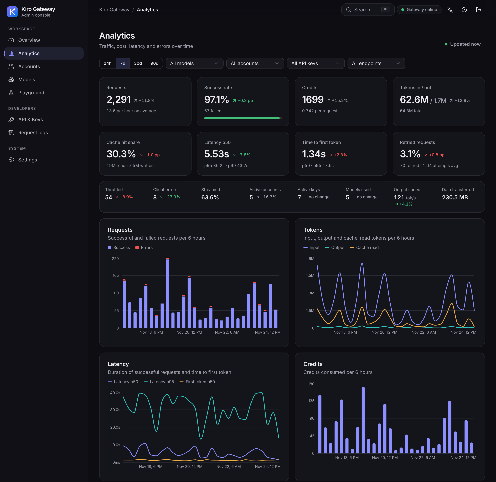
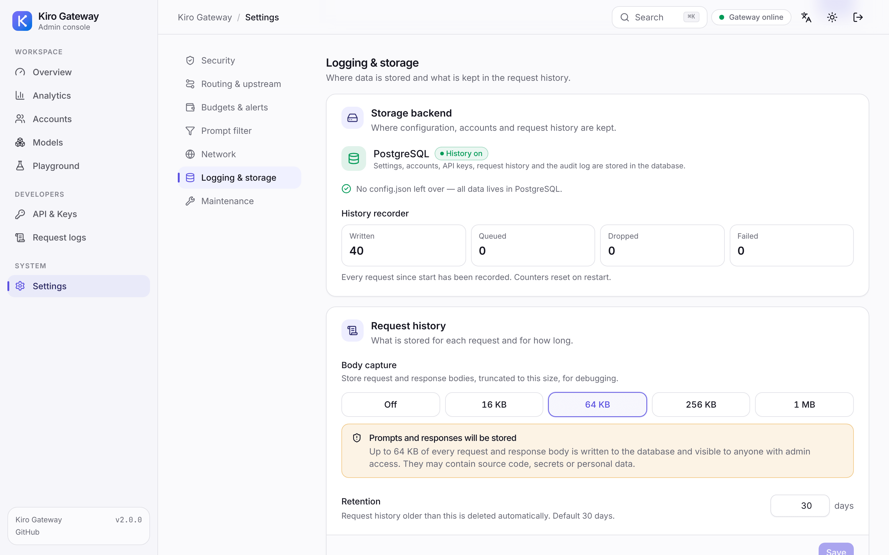

<div align="center">


# Kiro Gateway

**Use your Kiro accounts with the tools you already have — Claude Code, Codex, IDE agents and any OpenAI- or Anthropic-compatible SDK.**

A self-hosted gateway with a polished admin console, account pooling, usage analytics and cost controls.

[](https://github.com/springmusk026/Kiro-Gateway/actions/workflows/ci.yml)
[](https://github.com/springmusk026/Kiro-Gateway/pkgs/container/kiro-gateway)
[](go.mod)
[](LICENSE)

[Quick start](#quick-start) · [Connect your tools](#connect-your-tools) · [Documentation](#documentation) · [Changelog](CHANGELOG.md)

English · [中文](README_CN.md) · [Tiếng Việt](README_VI.md)

<br />



</div>

## Why Kiro Gateway

Kiro gives you access to strong models, but only inside Kiro's own apps. Kiro Gateway puts those accounts
behind the standard **Anthropic** and **OpenAI** APIs, so the agents and tools you prefer work with them
unchanged — and adds the operational layer a team needs: a shared account pool, per-person API keys,
spending limits and a clear view of what is being used.

| | |
|---|---|
| **Works with your tools** | Claude Code, Codex, Cline, Continue, Cursor, LiteLLM and the official SDKs connect with a base URL and a key. Streaming, tools, images, documents and extended thinking behave like the official APIs. |
| **One pool, many accounts** | Add accounts with Builder ID, IAM Identity Center, Microsoft SSO or Kiro API keys. Requests are spread across healthy accounts, conversations stay on one account to keep prompt caching effective, and accounts close to their limit are spared. |
| **Cost under control** | Daily credit caps for the whole gateway and for each key, alerts at 80% and 100% (in the console and to Slack or Discord), per-model enable/disable and automatic fallback when a model is unavailable. |
| **See everything** | Full request history, analytics with trends and breakdowns by model, account, key and client, cost at API list prices vs Kiro credits, an audit log of admin changes, and Prometheus metrics. |
| **Safe by default** | Session-based admin login, API keys with model allow-lists, rate limits and expiry, credentials encrypted at rest, and careful, client-like behaviour towards Kiro's servers. |

## Why this exists

Kiro's models are excellent, and a Kiro subscription is good value. The experience around them is where many
developers get stuck. Kiro's agent and orchestration — how it plans multi-step work, edits files, uses tools,
manages context and works in the terminal — doesn't yet match Claude Code or Codex for day-to-day engineering.
Those tools are what people already know, script and trust.

Kiro Gateway lets you keep your Kiro subscription and use it from the agent you prefer. Nothing more: you still
pay for your own accounts, use them within their limits, and get the same models through a better workflow.

## A note for the Kiro team

If you work on Kiro and are reviewing this project: we built it because we like Kiro's models and want to keep
using them, not to get around paying for them. The most useful outcome would be for Kiro to make this gateway
unnecessary. A few things would do that:

- **Official API access** for subscribers, with documented endpoints, keys and usage reporting, so tools like
  Claude Code and Codex can be pointed at Kiro directly.
- **A stronger agent experience** in Kiro itself: better planning and orchestration, faster and more reliable
  tool use, context management that holds up in long sessions, and a first-class terminal workflow.
- **Interoperability**: support for open agent protocols and standard API formats, so developers can bring
  the tools they already use.

In the meantime, the gateway is designed to be a well-behaved client:

- It only uses accounts their owners connect, within their own quotas.
- It honours Kiro's rate-limit and retry signals, never replays rejected requests, caps the upstream attempts
  per request, and backs off accounts that are throttled or out of quota.
- It keeps conversations on one account so prompt caching works as intended, and answers what it can locally
  (token counts, start-up probes) instead of calling Kiro.
- It is meant for people and teams using their own accounts, not for reselling access, and it aims to add no
  load beyond what the same developers would generate in Kiro's own apps.

We're glad to talk. If something here causes problems for Kiro, please
[open an issue](https://github.com/springmusk026/Kiro-Gateway/issues) or contact the maintainers, and we'll work
with you on it.

## A quick tour

<table>
  <tr>
    <td width="50%"><br /><b>Analytics</b> — requests, success rate, credits, tokens, cache share and latency, with trends and breakdowns.</td>
    <td width="50%"><br /><b>Accounts</b> — health, quota and credits left for every account in the pool.</td>
  </tr>
  <tr>
    <td><br /><b>Playground</b> — try any model with streaming and visible reasoning, then copy the request as cURL.</td>
    <td><br /><b>API & Keys</b> — ready-to-paste setup for each tool, and keys with limits and restrictions.</td>
  </tr>
  <tr>
    <td><br /><b>Request logs</b> — every request with timing, routing, usage and (optionally) bodies.</td>
    <td><br /><b>Models</b> — the live catalogue, aliases, fallbacks and thinking behaviour.</td>
  </tr>
  <tr>
    <td><br /><b>Dark mode</b> — every page, in light and dark.</td>
    <td><br /><b>Settings</b> — routing, budgets and alerts, security, logging and storage.</td>
  </tr>
</table>

The console is available in English, 中文 and Tiếng Việt and works on phones.

## Quick start

You need Docker with Docker Compose.

```bash
git clone https://github.com/springmusk026/Kiro-Gateway.git
cd Kiro-Gateway
docker compose up -d
```

This starts the gateway on port **8080** together with a PostgreSQL database. Then:

1. Find the generated admin password: `docker compose logs kiro-gateway | grep -i password`
   (or set your own with `ADMIN_PASSWORD` in a `.env` file before starting).
2. Open **http://localhost:8080/admin** and sign in.
3. **Accounts → Add account** to connect a Kiro account.
4. **API & Keys → Create key**, then follow the setup snippet for your tool.

To update later:

```bash
git pull && docker compose up -d --build --remove-orphans
```

Other ways to run it — the prebuilt image, building from source, or without a database — are covered in
[docs/installation.md](docs/installation.md). Moving from an earlier Kiro-Go setup? See
[docs/upgrading.md](docs/upgrading.md).

## Connect your tools

The **API & Keys** page generates these snippets with your server address, key and preferred models.

**Claude Code**

```bash
export ANTHROPIC_BASE_URL=http://localhost:8080
export ANTHROPIC_AUTH_TOKEN=<your-gateway-key>
export ANTHROPIC_MODEL=claude-sonnet-4.5
claude
```

**Codex CLI** — in `~/.codex/config.toml`:

```toml
model = "claude-sonnet-4.5"
model_provider = "kiro"

[model_providers.kiro]
name = "Kiro Gateway"
base_url = "http://localhost:8080/v1"
env_key = "KIRO_API_KEY"
wire_api = "responses"
```

**SDKs and other tools** — use `http://localhost:8080/v1` as the OpenAI base URL or `http://localhost:8080`
as the Anthropic base URL, with a gateway API key.

Setup for Cline, Continue, Cursor, LiteLLM and cURL, and how to turn on extended thinking per tool, is in
[docs/clients.md](docs/clients.md).

## Documentation

| Guide | |
|---|---|
| [Installation](docs/installation.md) | Docker Compose, prebuilt image, from source, production checklist |
| [Connecting clients](docs/clients.md) | Claude Code, Codex, IDE agents, SDKs, LiteLLM |
| [Configuration](docs/configuration.md) | Settings, environment variables, storage, logging, budgets |
| [API reference](docs/api.md) | Endpoints, compatibility notes, thinking, errors |
| [Architecture](docs/architecture.md) | How requests flow, account pooling, caching and cost |
| [Upgrading](docs/upgrading.md) | Moving from Kiro-Go, JSON to PostgreSQL, version notes |
| [Troubleshooting](docs/troubleshooting.md) | Common problems and how to solve them |
| [Development](docs/development.md) | Building, testing and contributing code |

## Security

Kiro Gateway gives access to your Kiro accounts, so treat it like any credential store:

- Turn on **Require an API key** (Settings → Security) and create keys before exposing the gateway beyond
  your machine, and put TLS in front of it (Caddy, nginx, Cloudflare).
- Set `KIRO_ENCRYPTION_KEY` to encrypt account credentials at rest, and keep a copy of it somewhere safe.
- Request and response bodies are not stored unless you turn that on.

See [SECURITY.md](SECURITY.md) for the full checklist and how to report a vulnerability.

## Contributing

Bug reports, ideas and pull requests are welcome. Please read [CONTRIBUTING.md](CONTRIBUTING.md) and our
[Code of Conduct](CODE_OF_CONDUCT.md) first; [SUPPORT.md](SUPPORT.md) explains where to ask questions.

## Acknowledgements

Kiro Gateway began as a fork of [Quorinex/Kiro-Go](https://github.com/Quorinex/Kiro-Go) and has since been
rebuilt and extended. Thanks to its author and contributors.

## Disclaimer

Kiro Gateway is an independent project and is not affiliated with, endorsed by or supported by Amazon, AWS or
Kiro. You are responsible for using it in line with the terms of service of the accounts you connect and
with applicable law.

## License

[MIT](LICENSE)
