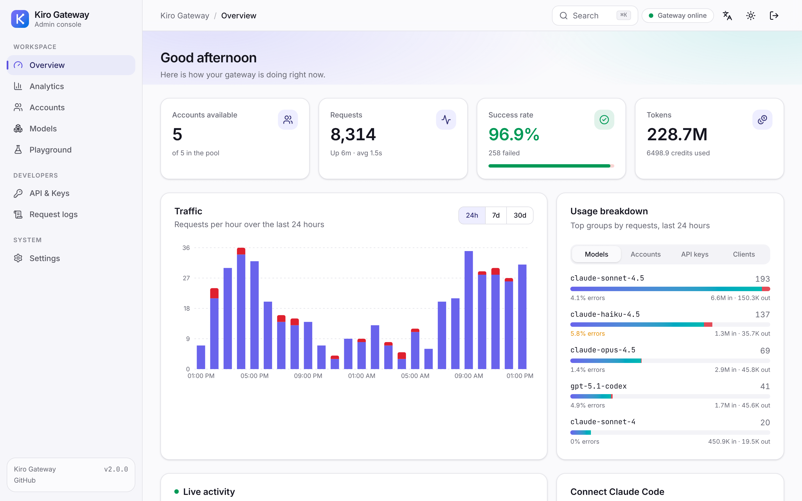
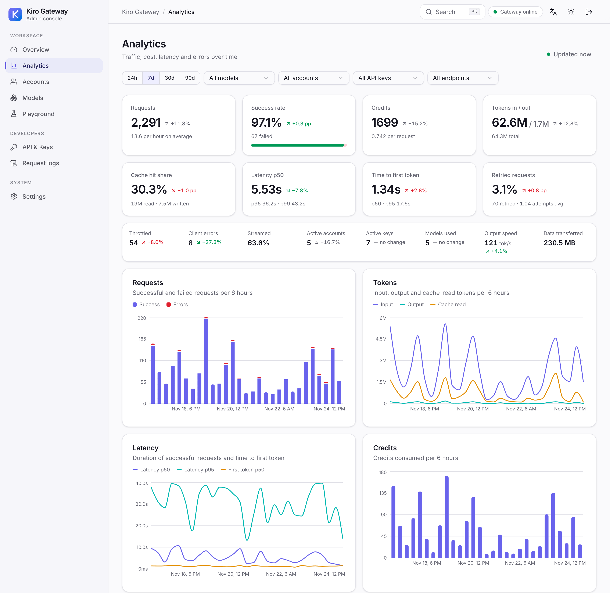
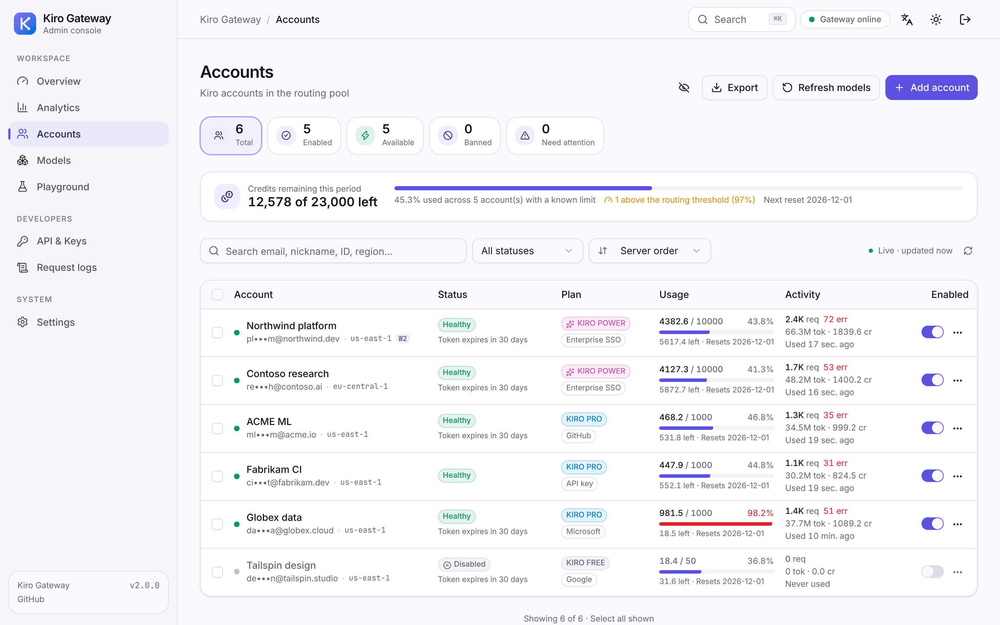
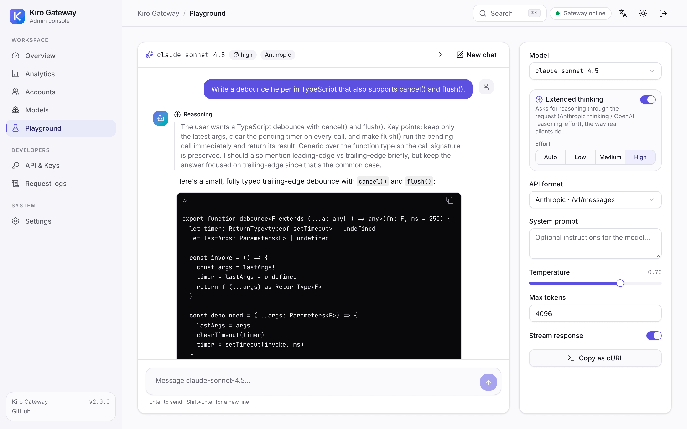
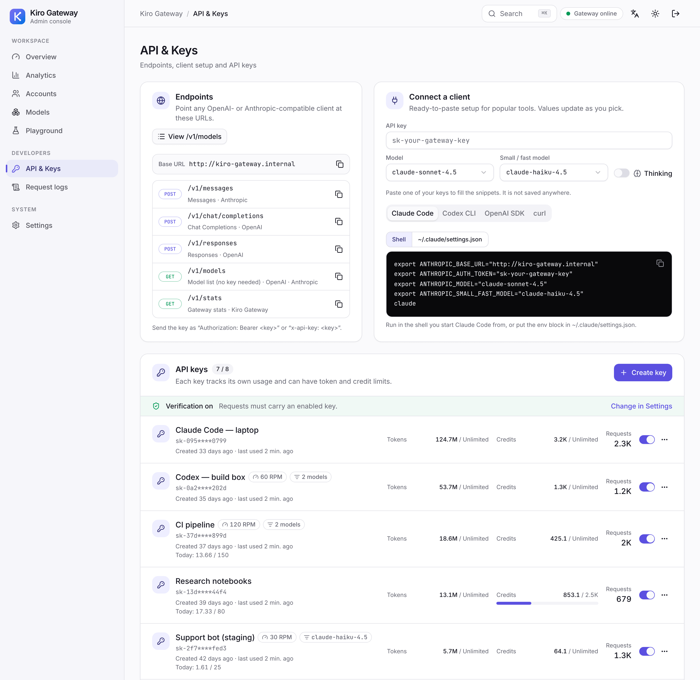
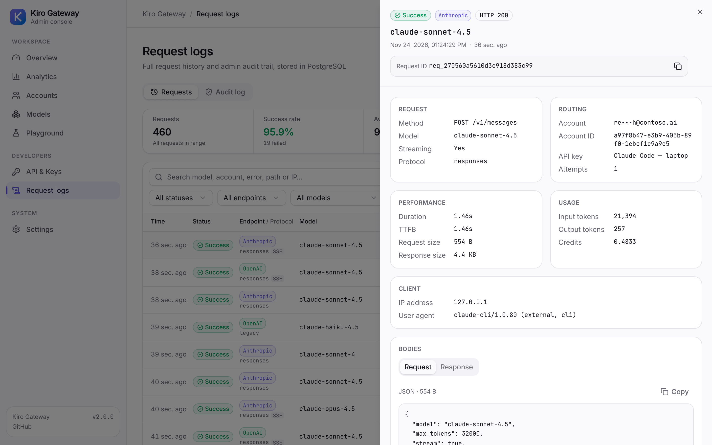
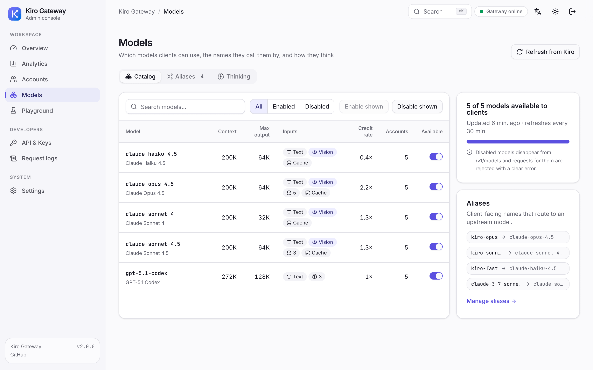

<div align="center">


# Kiro Gateway

**让你的 Kiro 账号直接用于 Claude Code、Codex、IDE 智能体以及任何兼容 OpenAI / Anthropic 的 SDK。**

自托管网关，附带专业的管理控制台、账号池、用量分析与成本控制。

[](https://github.com/springmusk026/Kiro-Gateway/actions/workflows/ci.yml)
[](https://github.com/springmusk026/Kiro-Gateway/pkgs/container/kiro-gateway)
[](go.mod)
[](LICENSE)

[English](README.md) · 中文 · [Tiếng Việt](README_VI.md)

<br />



</div>

## 为什么选择 Kiro Gateway

Kiro 提供了强大的模型，但只能在 Kiro 自己的应用中使用。Kiro Gateway 将这些账号以标准的 **Anthropic** 与 **OpenAI**
接口提供出来，你常用的智能体和工具无需修改即可接入；同时提供团队所需的运维能力：共享账号池、按人分配的 API Key、
花费上限，以及清晰的用量视图。

| | |
|---|---|
| **兼容你的工具** | Claude Code、Codex、Cline、Continue、Cursor、LiteLLM 及官方 SDK 只需配置地址和密钥即可使用；流式输出、工具调用、图片、文档与扩展思考的行为与官方 API 一致。 |
| **一个账号池，多个账号** | 支持 Builder ID、IAM Identity Center、Microsoft SSO 与 Kiro API Key。请求在健康账号间分配，同一会话固定在同一账号以充分利用提示缓存，接近额度上限的账号会被优先避开。 |
| **成本可控** | 全局与单个密钥的每日额度上限，80% 与 100% 时在控制台及 Slack / Discord 中提醒；可按模型启用或禁用，模型不可用时自动回退。 |
| **一切可见** | 完整的请求记录、按模型 / 账号 / 密钥 / 客户端的趋势与分布分析、管理操作审计日志，以及 Prometheus 指标。 |
| **默认安全** | 基于会话的管理登录，支持模型白名单、速率限制与过期时间的 API Key，凭证静态加密，对 Kiro 服务器的访问方式与官方客户端保持一致。 |

## 为什么做这个项目

Kiro 的模型非常出色，订阅也很划算，但围绕模型的使用体验让很多开发者止步：Kiro 的智能体与编排能力——如何规划多步任务、
编辑文件、调用工具、管理上下文以及在终端中工作——在日常工程中还比不上 Claude Code 或 Codex，而后者正是开发者已经熟悉、
可以脚本化并且信任的工具。

Kiro Gateway 让你保留 Kiro 订阅，同时用自己喜欢的智能体来使用它。仅此而已：账号仍由你自己付费，在各自额度内使用，
通过更好的工作流获得同样的模型。

## 致 Kiro 团队

如果你在 Kiro 工作并正在审阅本项目：我们做它，是因为喜欢 Kiro 的模型并希望继续使用，而不是为了逃避付费。最好的结果是
Kiro 让这个网关变得没有必要，例如：

- 为订阅用户提供**官方 API**（有文档的接口、密钥与用量报告），让 Claude Code、Codex 等工具可以直接接入 Kiro；
- 在 Kiro 中提供**更强的智能体体验**：更好的规划与编排、更快更可靠的工具调用、长会话中稳定的上下文管理，以及一流的终端工作流；
- **互操作性**：支持开放的智能体协议和标准 API 格式，让开发者沿用已有工具。

在此之前，本网关力求做一个守规矩的客户端：只使用账号所有者自行接入的账号并遵守其额度；遵循 Kiro 的限流与重试信号，
不重放被拒绝的请求，限制每个请求的上游尝试次数，并让被限流或额度耗尽的账号暂停使用；将同一会话固定在同一账号以发挥提示缓存的作用，
能在本地完成的（如 Token 计数、启动探测）不调用 Kiro；它面向使用自己账号的个人与团队，而非转售访问，并力求不产生超出这些开发者在 Kiro 官方应用中本会产生的负载。

我们乐意沟通。如果本项目给 Kiro 带来了问题，请[提交 issue](https://github.com/springmusk026/Kiro-Gateway/issues) 或联系维护者，我们会与你一起解决。

## 界面一览

<table>
  <tr>
    <td width="50%"><br /><b>分析</b> —— 请求量、成功率、额度、Token、缓存占比与延迟，含趋势与分布。</td>
    <td width="50%"><br /><b>账号</b> —— 每个账号的健康状态、额度与剩余用量。</td>
  </tr>
  <tr>
    <td><br /><b>Playground</b> —— 流式对话与可见推理，可复制为 cURL。</td>
    <td><br /><b>API 与密钥</b> —— 各工具的即用配置，以及带限额与限制的密钥。</td>
  </tr>
  <tr>
    <td><br /><b>请求日志</b> —— 每个请求的耗时、路由、用量与（可选）请求体。</td>
    <td><br /><b>模型</b> —— 实时模型目录、别名、回退与思考设置。</td>
  </tr>
</table>

控制台支持 English、中文与 Tiếng Việt，并适配手机。

## 快速开始

需要 Docker 与 Docker Compose。

```bash
git clone https://github.com/springmusk026/Kiro-Gateway.git
cd Kiro-Gateway
docker compose up -d
```

网关将运行在 **8080** 端口，并附带一个 PostgreSQL 数据库。接下来：

1. 查看自动生成的管理员密码：`docker compose logs kiro-gateway | grep -i password`（也可以在启动前于 `.env` 中设置 `ADMIN_PASSWORD`）。
2. 打开 **http://localhost:8080/admin** 并登录。
3. **账号 → 添加账号**，接入 Kiro 账号。
4. **API 与密钥 → 创建密钥**，按对应工具的配置片段完成接入。

后续更新：

```bash
git pull && docker compose up -d --build --remove-orphans
```

其他部署方式见 [docs/installation.md](docs/installation.md)；从旧版 Kiro-Go 升级请参阅 [docs/upgrading.md](docs/upgrading.md)。

## 接入工具

**API 与密钥** 页面会根据你的服务器地址、密钥和模型生成以下配置。

**Claude Code**

```bash
export ANTHROPIC_BASE_URL=http://localhost:8080
export ANTHROPIC_AUTH_TOKEN=<你的网关密钥>
export ANTHROPIC_MODEL=claude-sonnet-4.5
claude
```

**Codex CLI**（`~/.codex/config.toml`）

```toml
model = "claude-sonnet-4.5"
model_provider = "kiro"

[model_providers.kiro]
name = "Kiro Gateway"
base_url = "http://localhost:8080/v1"
env_key = "KIRO_API_KEY"
wire_api = "responses"
```

**SDK 与其他工具**：OpenAI 地址使用 `http://localhost:8080/v1`，Anthropic 地址使用 `http://localhost:8080`，并使用网关 API Key。
更多工具与思考模式设置见 [docs/clients.md](docs/clients.md)。

## 文档（英文）

| 指南 | |
|---|---|
| [安装](docs/installation.md) | Docker Compose、预构建镜像、源码构建、生产环境清单 |
| [接入客户端](docs/clients.md) | Claude Code、Codex、IDE 智能体、SDK、LiteLLM |
| [配置](docs/configuration.md) | 设置项、环境变量、存储、日志、预算 |
| [API 参考](docs/api.md) | 接口、兼容性说明、思考模式、错误码 |
| [架构](docs/architecture.md) | 请求流程、账号池、缓存与成本 |
| [升级](docs/upgrading.md) | 从 Kiro-Go 迁移、JSON 迁移到 PostgreSQL |
| [故障排查](docs/troubleshooting.md) | 常见问题与解决方法 |
| [开发](docs/development.md) | 构建、测试与贡献代码 |

## 安全

网关掌握着你的 Kiro 账号凭证，请像对待凭证库一样对待它：对外开放前请在 设置 → 安全 中开启 **要求 API 密钥** 并创建密钥，
在前面加上 HTTPS；设置 `KIRO_ENCRYPTION_KEY` 以加密存储凭证并妥善备份该密钥。详见 [SECURITY.md](SECURITY.md)。

## 参与贡献

欢迎提交问题、建议与 Pull Request，请先阅读 [CONTRIBUTING.md](CONTRIBUTING.md) 与 [行为准则](CODE_OF_CONDUCT.md)。

## 致谢

Kiro Gateway 最初基于 [Quorinex/Kiro-Go](https://github.com/Quorinex/Kiro-Go) 分叉，并已全面重写与扩展。感谢原作者及贡献者。

## 免责声明

Kiro Gateway 为独立项目，与 Amazon、AWS 或 Kiro 无任何关联，也未获其认可或支持。使用者须自行遵守所接入账号的服务条款及相关法律。

## 许可证

[MIT](LICENSE)
