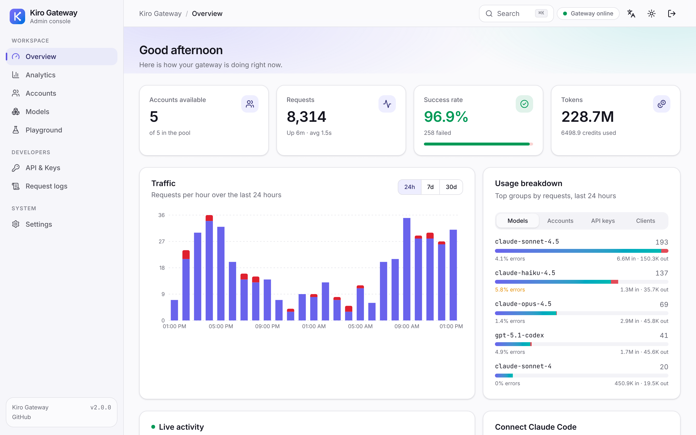
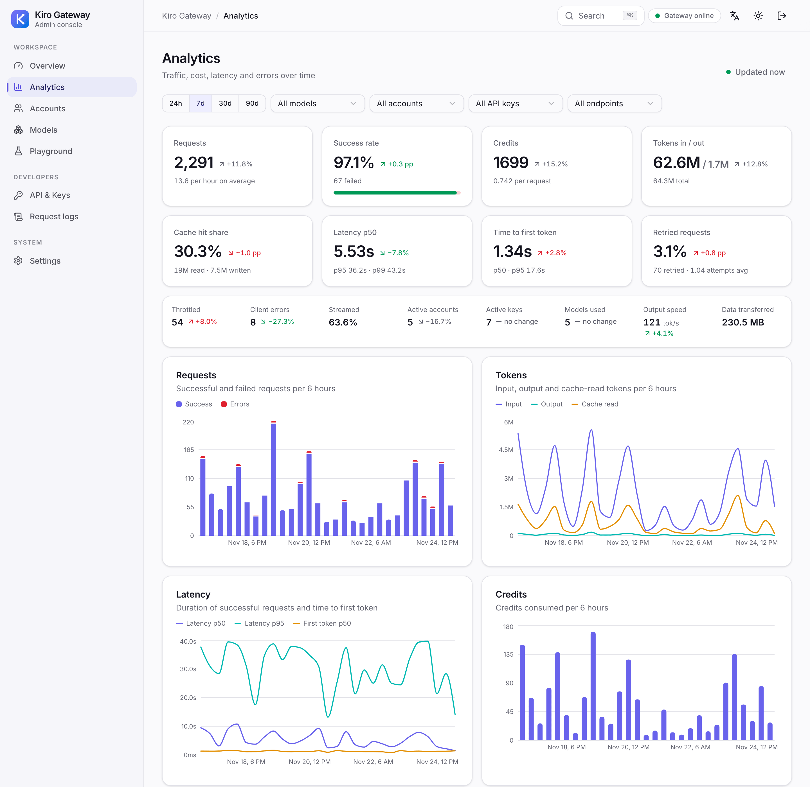
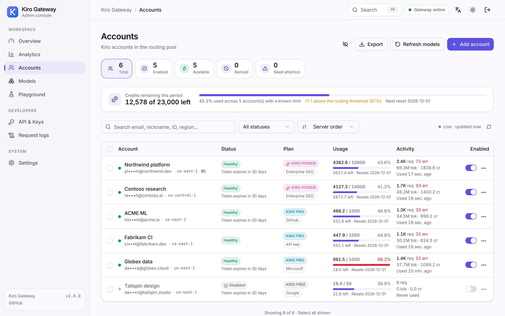
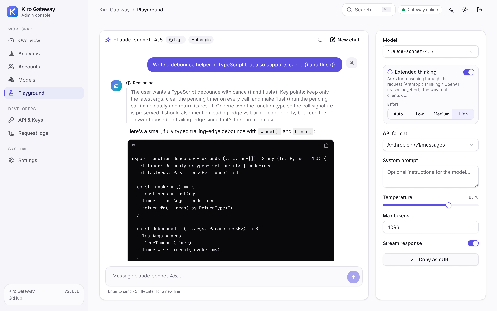
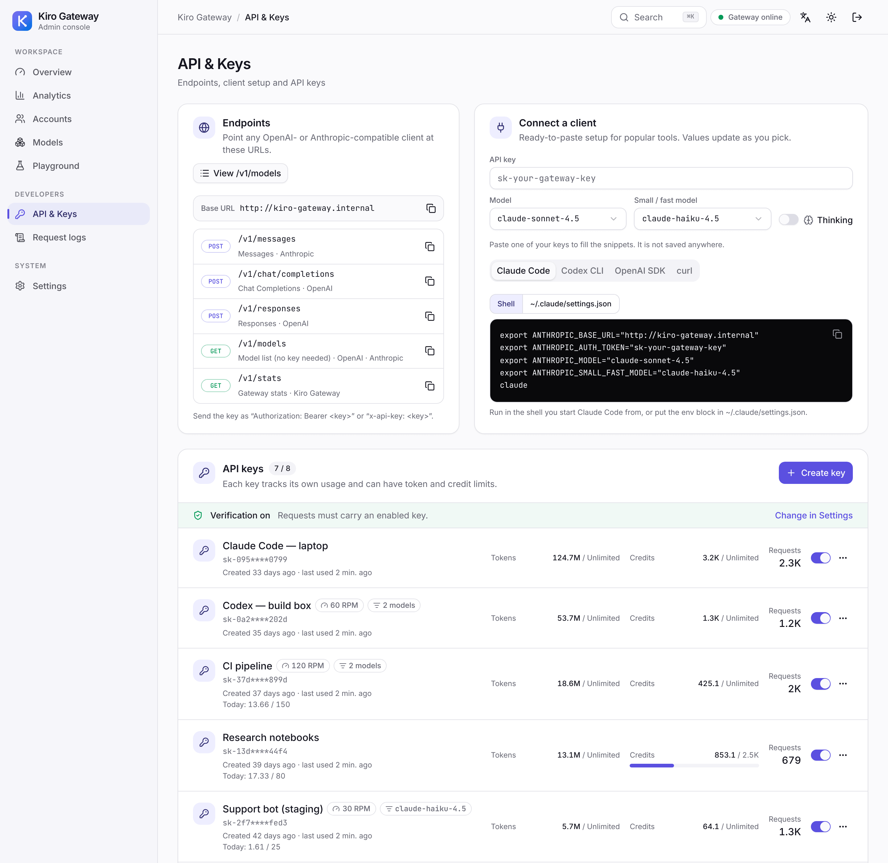
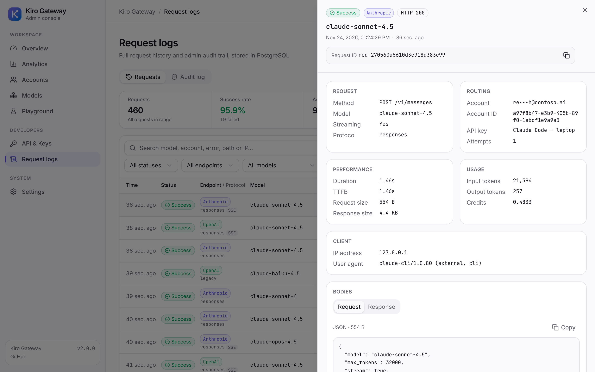
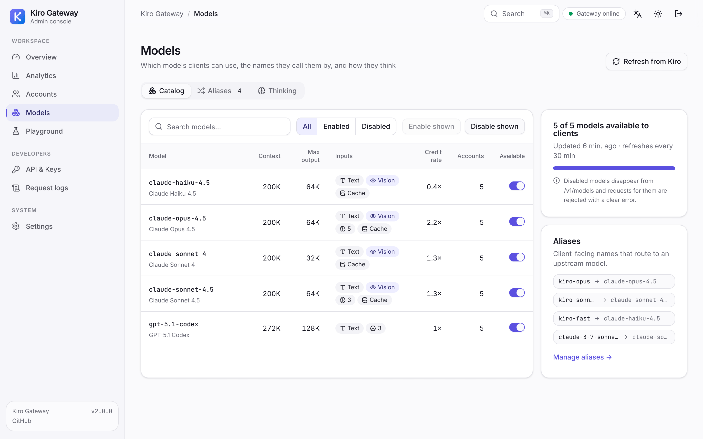

<div align="center">


# Kiro Gateway

**Dùng tài khoản Kiro với chính các công cụ bạn đang dùng — Claude Code, Codex, agent trong IDE và mọi SDK tương thích OpenAI hoặc Anthropic.**

Gateway tự host với bảng quản trị chuyên nghiệp, nhóm tài khoản, phân tích mức sử dụng và kiểm soát chi phí.

[](https://github.com/springmusk026/Kiro-Gateway/actions/workflows/ci.yml)
[](https://github.com/springmusk026/Kiro-Gateway/pkgs/container/kiro-gateway)
[](go.mod)
[](LICENSE)

[English](README.md) · [中文](README_CN.md) · Tiếng Việt

<br />



</div>

## Vì sao chọn Kiro Gateway

Kiro cung cấp các mô hình mạnh nhưng chỉ dùng được trong ứng dụng của Kiro. Kiro Gateway đưa các tài khoản đó ra
sau API **Anthropic** và **OpenAI** tiêu chuẩn, để agent và công cụ bạn quen dùng hoạt động mà không cần sửa đổi —
kèm theo những gì một nhóm cần: nhóm tài khoản dùng chung, API key cho từng người, giới hạn chi tiêu và cái nhìn rõ
ràng về mức sử dụng.

| | |
|---|---|
| **Tương thích công cụ của bạn** | Claude Code, Codex, Cline, Continue, Cursor, LiteLLM và SDK chính thức chỉ cần base URL và key. Streaming, công cụ, hình ảnh, tài liệu và extended thinking hoạt động như API chính thức. |
| **Một nhóm, nhiều tài khoản** | Thêm tài khoản bằng Builder ID, IAM Identity Center, Microsoft SSO hoặc Kiro API key. Request được phân bổ giữa các tài khoản khỏe mạnh, mỗi cuộc hội thoại giữ trên một tài khoản để tận dụng prompt cache, và tài khoản gần hết hạn mức được ưu tiên tránh. |
| **Kiểm soát chi phí** | Giới hạn credit theo ngày cho toàn gateway và từng key, cảnh báo ở 80% và 100% (trong bảng quản trị và qua Slack hoặc Discord), bật/tắt từng mô hình và tự chuyển sang mô hình dự phòng khi cần. |
| **Thấy rõ mọi thứ** | Lịch sử request đầy đủ, phân tích xu hướng theo mô hình, tài khoản, key và client, nhật ký thao tác quản trị và Prometheus metrics. |
| **An toàn mặc định** | Đăng nhập quản trị bằng phiên, API key với danh sách mô hình cho phép, giới hạn tốc độ và hạn dùng, mã hóa thông tin xác thực khi lưu trữ, và cách gọi máy chủ Kiro giống client chính thức. |

## Vì sao có dự án này

Các mô hình của Kiro rất tốt và gói đăng ký đáng giá. Điều khiến nhiều lập trình viên vướng mắc là trải nghiệm xung quanh:
agent và khả năng điều phối của Kiro — lập kế hoạch nhiều bước, sửa file, dùng công cụ, quản lý ngữ cảnh và làm việc trong
terminal — vẫn chưa bằng Claude Code hay Codex trong công việc hằng ngày, trong khi đó lại là những công cụ mọi người đã quen,
tự động hóa được và tin dùng.

Kiro Gateway cho phép bạn giữ gói Kiro và dùng nó từ agent bạn thích. Chỉ vậy thôi: bạn vẫn trả tiền cho tài khoản của mình,
dùng trong hạn mức của chúng và nhận cùng các mô hình qua một quy trình làm việc tốt hơn.

## Gửi đội ngũ Kiro

Nếu bạn làm việc tại Kiro và đang xem xét dự án này: chúng tôi xây dựng nó vì thích các mô hình của Kiro và muốn tiếp tục dùng,
không phải để né việc trả phí. Kết quả tốt nhất là Kiro khiến gateway này trở nên không cần thiết, chẳng hạn:

- **API chính thức** cho người đăng ký, có tài liệu, key và báo cáo mức dùng, để Claude Code, Codex và các công cụ khác kết nối trực tiếp;
- **Trải nghiệm agent mạnh hơn** ngay trong Kiro: lập kế hoạch và điều phối tốt hơn, dùng công cụ nhanh và ổn định hơn, quản lý ngữ cảnh tốt trong phiên dài và quy trình terminal hạng nhất;
- **Khả năng tương tác**: hỗ trợ giao thức agent mở và định dạng API tiêu chuẩn.

Trong lúc đó, gateway được thiết kế để là một client đúng mực: chỉ dùng tài khoản do chính chủ kết nối và trong hạn mức của họ;
tuân theo tín hiệu giới hạn tốc độ và thử lại của Kiro, không gửi lại request bị từ chối, giới hạn số lần gọi upstream cho mỗi request
và tạm nghỉ tài khoản bị giới hạn hoặc hết hạn mức; giữ mỗi cuộc hội thoại trên một tài khoản để prompt cache hoạt động đúng, và tự xử lý
những gì có thể (đếm token, request khởi động) thay vì gọi Kiro; dành cho cá nhân và nhóm dùng tài khoản của chính mình, không phải để bán lại quyền truy cập, và cố gắng không tạo thêm tải ngoài mức
các lập trình viên đó vốn tạo ra trong ứng dụng của Kiro.

Chúng tôi sẵn lòng trao đổi. Nếu dự án gây vấn đề cho Kiro, hãy [mở issue](https://github.com/springmusk026/Kiro-Gateway/issues)
hoặc liên hệ người duy trì, chúng tôi sẽ cùng giải quyết.

## Tham quan nhanh

<table>
  <tr>
    <td width="50%"><br /><b>Phân tích</b> — request, tỷ lệ thành công, credit, token, tỷ lệ cache và độ trễ, kèm xu hướng.</td>
    <td width="50%"><br /><b>Tài khoản</b> — tình trạng, hạn mức và credit còn lại của từng tài khoản.</td>
  </tr>
  <tr>
    <td><br /><b>Playground</b> — thử mô hình với streaming và phần suy luận hiển thị, sao chép dạng cURL.</td>
    <td><br /><b>API & Keys</b> — cấu hình sẵn cho từng công cụ, key với giới hạn và hạn chế.</td>
  </tr>
  <tr>
    <td><br /><b>Nhật ký request</b> — thời gian, định tuyến, mức dùng và (tùy chọn) nội dung từng request.</td>
    <td><br /><b>Mô hình</b> — danh mục trực tiếp, bí danh, dự phòng và thinking.</td>
  </tr>
</table>

Bảng quản trị có English, 中文 và Tiếng Việt, dùng tốt trên điện thoại.

## Bắt đầu nhanh

Cần Docker và Docker Compose.

```bash
git clone https://github.com/springmusk026/Kiro-Gateway.git
cd Kiro-Gateway
docker compose up -d
```

Gateway chạy ở cổng **8080** cùng một cơ sở dữ liệu PostgreSQL. Tiếp theo:

1. Xem mật khẩu quản trị được tạo: `docker compose logs kiro-gateway | grep -i password` (hoặc đặt `ADMIN_PASSWORD` trong file `.env` trước khi chạy).
2. Mở **http://localhost:8080/admin** và đăng nhập.
3. **Tài khoản → Thêm tài khoản** để kết nối tài khoản Kiro.
4. **API & Keys → Tạo key**, rồi làm theo đoạn cấu hình cho công cụ của bạn.

Cập nhật về sau:

```bash
git pull && docker compose up -d --build --remove-orphans
```

Các cách cài đặt khác: [docs/installation.md](docs/installation.md). Nâng cấp từ Kiro-Go: [docs/upgrading.md](docs/upgrading.md).

## Kết nối công cụ

**Claude Code**

```bash
export ANTHROPIC_BASE_URL=http://localhost:8080
export ANTHROPIC_AUTH_TOKEN=<gateway-key-cua-ban>
export ANTHROPIC_MODEL=claude-sonnet-4.5
claude
```

**Codex CLI** (`~/.codex/config.toml`)

```toml
model = "claude-sonnet-4.5"
model_provider = "kiro"

[model_providers.kiro]
name = "Kiro Gateway"
base_url = "http://localhost:8080/v1"
env_key = "KIRO_API_KEY"
wire_api = "responses"
```

**SDK và công cụ khác**: base URL OpenAI là `http://localhost:8080/v1`, Anthropic là `http://localhost:8080`, kèm API key của gateway.
Xem thêm: [docs/clients.md](docs/clients.md).

## Tài liệu (tiếng Anh)

| Hướng dẫn | |
|---|---|
| [Cài đặt](docs/installation.md) | Docker Compose, image dựng sẵn, build từ mã nguồn, triển khai production |
| [Kết nối client](docs/clients.md) | Claude Code, Codex, agent trong IDE, SDK, LiteLLM |
| [Cấu hình](docs/configuration.md) | Cài đặt, biến môi trường, lưu trữ, log, ngân sách |
| [API](docs/api.md) | Endpoint, tương thích, thinking, mã lỗi |
| [Kiến trúc](docs/architecture.md) | Luồng request, nhóm tài khoản, cache và chi phí |
| [Nâng cấp](docs/upgrading.md) | Chuyển từ Kiro-Go, từ JSON sang PostgreSQL |
| [Khắc phục sự cố](docs/troubleshooting.md) | Sự cố thường gặp và cách xử lý |
| [Phát triển](docs/development.md) | Build, kiểm thử và đóng góp mã |

## Bảo mật

Gateway nắm giữ thông tin đăng nhập tài khoản Kiro của bạn. Trước khi mở ra ngoài, hãy bật **Yêu cầu API key**
(Cài đặt → Bảo mật), tạo key và đặt HTTPS phía trước; đặt `KIRO_ENCRYPTION_KEY` để mã hóa thông tin xác thực và lưu giữ
khóa này an toàn. Xem [SECURITY.md](SECURITY.md).

## Đóng góp

Hoan nghênh báo lỗi, ý tưởng và pull request. Vui lòng đọc [CONTRIBUTING.md](CONTRIBUTING.md) và [Quy tắc ứng xử](CODE_OF_CONDUCT.md).

## Ghi nhận

Kiro Gateway khởi đầu là một bản fork của [Quorinex/Kiro-Go](https://github.com/Quorinex/Kiro-Go) và đã được viết lại, mở rộng. Cảm ơn tác giả và những người đóng góp.

## Miễn trừ trách nhiệm

Kiro Gateway là dự án độc lập, không liên kết, không được Amazon, AWS hay Kiro xác nhận hoặc hỗ trợ. Người dùng tự chịu trách nhiệm tuân thủ điều khoản dịch vụ của tài khoản và pháp luật liên quan.

## Giấy phép

[MIT](LICENSE)
